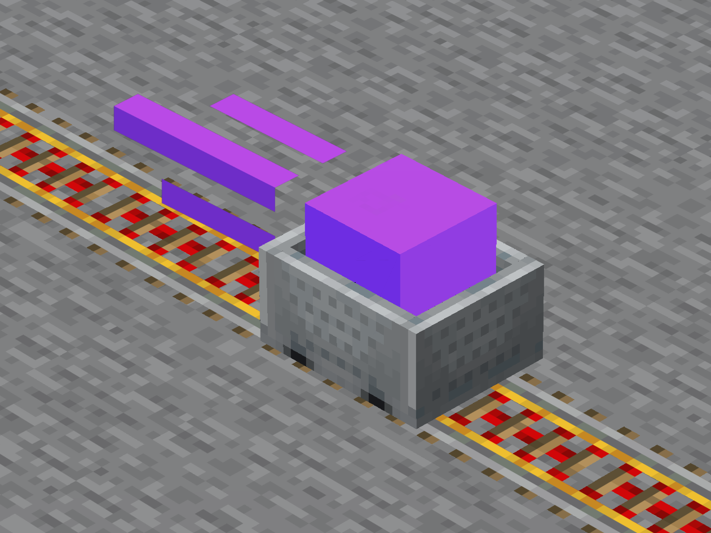

# Rail Builder (Meteor Addon)


<p align="center">
  
</p>

**Rail Builder** is a **Minecraft Meteor Client addon** for automated rail construction and tunnel building.
It provides configurable modules for building **powered rail systems**, **nether roof rails**, and **linear tunnel infrastructure** with minimal manual input.

Designed for **efficiency, automation, and long-distance travel builds**.

---

## Download

Latest release:
(https://github.com/killermelon1458/rail-builder/releases/latest)

---

## Features

* Fully automated **powered rail placement**
* Configurable **tunnel building (width, height, structure)**
* Supports **Baritone pathing and movement**
* Handles:

  * liquids (water / lava)
  * falling blocks (gravel / sand)
* Inventory-aware building logic
* Designed for **long-distance rail infrastructure**

---

## Modules

### PoweredRailBuilder

A **fully configurable tunnel + rail builder**.

**Capabilities:**

* Builds tunnels of configurable **width and height**
* Supports:

  * **All powered rails**
  * **Mixed rail modes**
* Configurable power systems:

  * redstone blocks
  * redstone torches
* Adjustable:

  * power spacing
  * rail offset
  * lighting placement
* Optional structural features:

  * walls and roof (shell)
  * multiple floor layers
  * power encapsulation
* Handles:

  * liquids before building
  * falling blocks before placement
* Integrates with **Baritone** for movement between build steps
* Includes **path recovery system** if movement stalls

**Use case:**

* Long-distance automated tunnel + rail construction
* Fully custom rail infrastructure

---

### RoofRailBuilder

A **specialized nether roof rail builder** optimized for speed and simplicity.

**Capabilities:**

* Builds straight powered rail lines on the **nether roof**
* Automatically places:

  * powered rails
  * power sources
* Includes **shulker-based restocking system**
* Automatically:

  * pauses when out of materials
  * resumes after restocking
* Supports:

  * persistent job saving
  * resume after reconnect
* Movement + placement optimized for **high efficiency**

**Use case:**

* Fast nether roof travel systems
* Minimal configuration, high reliability

---

## Supported environment and installation

This release targets **Minecraft 1.21.11 only**, Java 21 or later, and Fabric
Loader 0.18.2 or later. Meteor builds 37 and 86 were tested with Loader 0.18.2
and 0.20.1. See the [dependency policy and compatibility matrix](docs/DependencyCompatibility.md)
for the loading ranges, exact artifact hashes, and gameplay limitations.
Development retains Meteor 1.21.11-SNAPSHOT, Loader 0.18.2, Yarn 1.21.11+build.3,
and Fabric Loom 1.14-SNAPSHOT. Do not substitute Minecraft 26.x or Meteor builds
targeting another Minecraft version.

Install these separate mods in a Fabric 1.21.11 profile's `mods` directory:

* Meteor Client for 1.21.11 ([Meteor](https://meteorclient.com/)).
* Meteor's Baritone build `meteordevelopment:baritone:1.21.11-SNAPSHOT`
  ([artifact metadata](https://maven.meteordev.org/snapshots/meteordevelopment/baritone/1.21.11-SNAPSHOT/maven-metadata.xml)).
  Its Fabric mod ID is `baritone-meteor`. Use the JAR named by the metadata,
  not the sources JAR or an API-only distribution.
* The remapped Rail Builder release JAR.

Use exactly one Baritone installation. The addon does not bundle Meteor or Baritone.
The matching Meteor distribution supplies the Fabric API components it uses;
Rail Builder does not require the full Fabric API as a separate dependency.
Open Meteor's GUI (default Right Shift) and find both modules in **Linear Build**.

## Build and development client

With JDK 21 installed, from a fresh checkout:

```sh
./gradlew clean build --no-daemon --refresh-dependencies
./gradlew runClient
```

On Windows use `gradlew.bat`. Loom resolves Meteor and the matching Baritone mod
for the development client, plus Baritone's `dev.babbaj:nether-pathfinder:1.4.1`
library from `https://babbaj.github.io/maven/`. This library is runtime-only;
production Fabric loads the copy already nested in Baritone. Do not copy these
dependencies into `run/mods` or add another copy to a normal installation.
`runClient` needs a desktop display and working OpenGL. A successful build does
not prove client startup or gameplay. Inspect `run/logs/latest.log` for the loaded
mod list and `Initializing Linear Build Suite`; confirm both modules in the GUI.
A missing `Goal` or `ComeCommand` indicates a missing/incompatible Baritone runtime.

The distributable is `build/libs/rail-builder-1.21.11-0.1.5.jar` (not a dev or
sources JAR). Test it in a separate clean Fabric profile with the dependencies
above, then follow [the validation checklist](docs/Stabilization.md).
The version catalog `gradle/libs.versions.toml` is authoritative for all versions.

For dependency diagnostics:

```sh
./gradlew dependencies --configuration runtimeClasspath
./gradlew verifyBaritoneRuntime verifyPathfinderRuntime verifyDistribution
./gradlew verifyDependencyMetadata verifyInventoryTransfer
```

The build checks that a single complete Meteor Baritone provider is available at
runtime, loads NetherPathfinder and exercises its JNI context allocation/free,
checks that metadata and both module classes are packaged, and that dependencies
are not embedded. These checks do not initialize Minecraft or test gameplay.

## Delivering a changed addon

Every functionally distinct production deliverable must have a unique version.
For ordinary fixes, diagnostics, and small functional changes, increment the patch
in `gradle/libs.versions.toml`; never reuse a version for a different production
binary. Documentation-only changes do not require a version increment.

When implementation is complete, run `./gradlew runClient` on the available
graphical desktop, verify the main menu and Meteor/Rail Builder initialization,
and quit normally. A crash or timeout is not successful verification. Do not
recompile while the client is running. After confirmed shutdown, run
`./gradlew clean build --no-daemon` and verify the remapped JAR's filename,
metadata, and intended changes. Commit source changes and the version increment
locally, then report the JAR's absolute path, version, commit, test results and
limitations. Generated JARs are not committed. Remote operations require the
maintainer's manual review and action.

## Diagnostic logging

Both builders have a General → **debug-logging** toggle, OFF by default. Enable
it before reproducing an inventory failure, then inspect `[RailBuilder]` lines in
`run/logs/latest.log` (development) or your Minecraft profile's `logs/latest.log`.
See [inventory diagnostics and the redstone test matrix](docs/InventoryDiagnostics.md)
for commands, slot numbering, interpretation, and safe log extraction.

## GitHub Actions and releases

Build Verification runs on all pushes and pull requests, and can also be dispatched
manually. It uses Java 21, runs `clean build`, and uploads only the distributable
as the `rail-builder` artifact. Failures in compilation, dependency verification,
or packaging fail the job. Client launch is verified manually with the procedure
above; CI does not claim a graphical startup smoke test.

Publish Development Build is a separate **manual** workflow. After its clean build,
a dedicated publishing job with `contents: write` uploads the distributable to the
`snapshot` prerelease. Routine CI never publishes releases. Repository Actions
policies must permit these actions and manual publishing with the workflow token.

Release **v0.1.5** targets Minecraft 1.21.11. See the [release notes](docs/releases/v0.1.5.md)
and [verification record](docs/releases/v0.1.5-verification.md). Publishing is a maintainer action.
Snapshot dependencies can change upstream; `--refresh-dependencies` checks current
artifacts, so builds are not guaranteed byte-for-byte identical across time.

---

## Keywords

Minecraft rail builder mod, Meteor Client addon, Fabric rail builder, automated rail mod Minecraft, powered rail builder, nether roof rail builder, Baritone rail automation, Minecraft tunnel builder mod, rail automation Fabric mod

---

## License

This project is licensed under the CC0 1.0 Universal License.  
See the [LICENSE](LICENSE) file for details.
